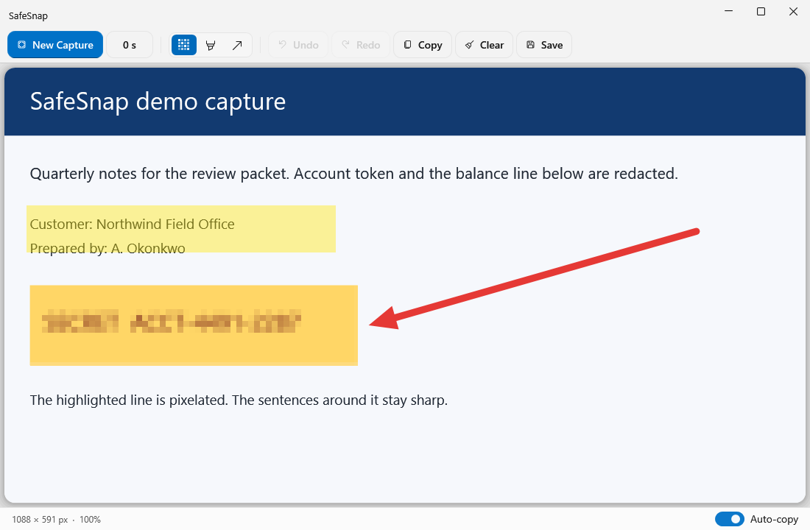
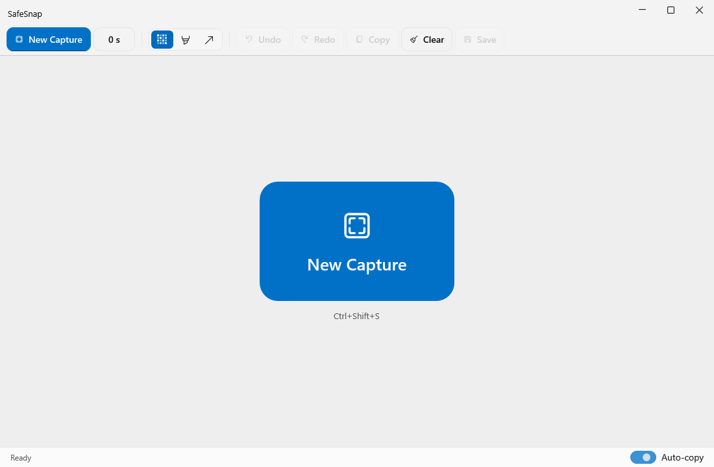
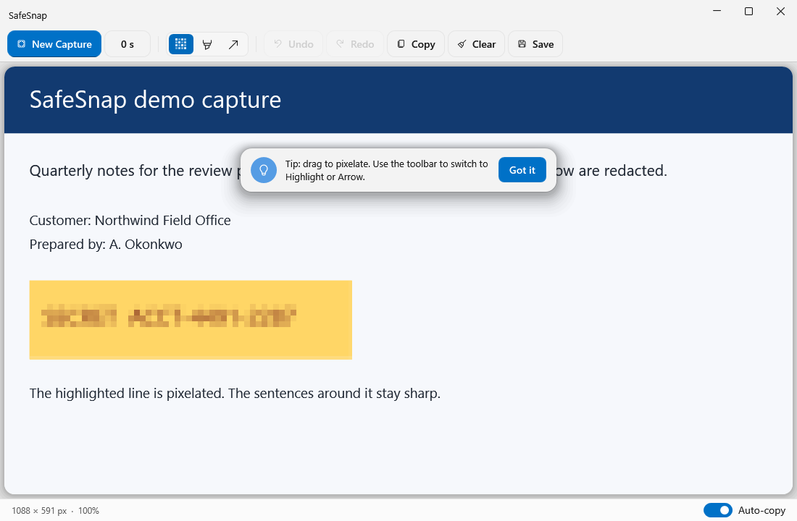

<p align="center">
  
</p>

<h1 align="center">SafeSnap</h1>

<p align="center">
  <b>Capture any region of your screen and pixelate sensitive info before you share it.</b><br>
  A fast, clean, privacy-first screenshot tool for Windows.
</p>

<p align="center">
  <a href="https://github.com/sirchas/SafeSnap/releases/latest"></a>
  <a href="LICENSE"></a>
  
  
</p>

<p align="center">
  
</p>

---

## Why SafeSnap?

Sharing a screenshot in a ticket, chat, or email often means exposing things you shouldn't: names, account numbers, email addresses, internal hostnames. SafeSnap makes it a two-second job: **snip, drag a box over the sensitive part, copy.** The pixelation is burned into the image, so the hidden text can't be recovered.

## Why it matters: Data Loss Prevention (DLP)

Screenshots are one of the easiest ways for sensitive data to leak. A quick capture for a ticket, chat or email can carry patient names and other PHI/PII, credentials and tokens, internal hostnames and IP addresses, or customer email addresses. Once shared, it gets forwarded, attached to tickets, indexed in chat history and stored indefinitely, far outside the systems built to protect that data. In regulated environments such as HIPAA, GDPR and PCI DSS, a single careless screenshot can become a reportable incident.

SafeSnap was built to be the path of least resistance. Capturing, pixelating, highlighting and redacting take seconds, all in one window, so doing the safe thing is also the easiest thing. Pixelation is destructive and everything stays on your machine, so what you share contains only what you meant to share. As of 1.2, every capture and edit lands on the clipboard by itself, so there's not even a Copy step to forget.

> SafeSnap is a personal side project I built on my own time. It's free, MIT-licensed, and comes with no support promises, just a tool I wanted to exist.

## Features

- 🖼️ **Region capture like Snipping Tool.** Freezes all monitors, dims the screen, and lets you drag a selection with crosshair guides and a live pixel-size readout. Handles multiple monitors and mixed DPI scaling (per-monitor DPI aware).
- 🟦 **Pixelate by default.** Just drag over anything sensitive and it's mosaicked. The edit is **destructive**: pixels are actually replaced, not overlaid.
- 🖍 **Highlight & Arrow tools.** Switch tools in the toolbar to drop a semi-transparent yellow highlight or a red arrow (drag sets direction and length).
- ↩️ **Undo / Redo** for every edit. All annotations are baked into the copied/saved image.
- 📋 **Auto-copy (on by default).** After every capture, pixelate, highlight, arrow, undo and redo, the current image is already on the clipboard as a real bitmap plus PNG, so it pastes cleanly into Outlook, Teams, Word, Slack, and more. Turn it off with the **Auto-copy** switch in the status bar; SafeSnap remembers your choice. **Copy** (`Ctrl+C`) still works any time.
- 🧹 **Clear.** One click on **Clear** wipes the screenshot out of SafeSnap (image, edits and undo history, back to the start screen) and empties the clipboard, so nothing lingers once you've shared it.
- 💾 **Save as PNG** to `Pictures\SafeSnap` with a timestamped filename.
- ⌨️ **Global hotkey** `Ctrl+Shift+S` works from anywhere, even when SafeSnap is in the tray.
- ⏱️ **Capture delay** (0 / 3 / 5 s) for menus and tooltips.
- 🧭 **System tray.** Closing the window keeps SafeSnap ready in the tray, with its icon shown right on the taskbar (not tucked under the ^ overflow on Windows 11); single-instance.
- 🌗 **Modern Windows 11 look** with Fluent design and Mica, following your light/dark theme.

<p align="center">
  &nbsp;
</p>

## Download & install

Grab the latest build from the **[Releases page](https://github.com/sirchas/SafeSnap/releases/latest)**:

| File | What it is |
|---|---|
| `SafeSnap-Setup-1.2.2.exe` | **Recommended.** Per-user installer (no admin needed). Adds a Start Menu shortcut, an optional Desktop icon, a Startup shortcut so SafeSnap waits in the tray after you sign in (ticked by default, easy to untick), and an uninstaller. Closes a running SafeSnap for you and relaunches the new version when it's done. |
| `SafeSnap-1.2.2-portable-win-x64.exe` | Portable single file. No install; just run it. |
| `SafeSnap-Setup-1.2.2.zip` | The installer in a zip (with a short README.txt). |
| `SafeSnap-1.2.2-portable-win-x64.zip` | The portable exe in a zip with LICENSE and README.txt. Extract anywhere and run. |

Both are self-contained (no .NET install required). Windows 10/11 x64.

> **SmartScreen note:** SafeSnap isn't code-signed yet, so Windows may show *"Windows protected your PC"*. Click **More info → Run anyway**. For the zips, right-click the zip > **Properties** > **Unblock** before extracting. You can verify your download against `SHA256SUMS.txt` on the release page.

## Usage

1. Click **New Capture** (or press `Ctrl+Shift+S` anywhere).
2. Drag a region on the frozen screen. `Esc` cancels.
3. Drag over anything sensitive; it's pixelated instantly. Pick **Highlight** or **Arrow** in the toolbar to call things out instead (arrows: drag from start to end).
4. Paste it wherever it's going. With Auto-copy on, the clipboard always holds the latest version (the status bar shows *On clipboard*). Or **Save** a PNG.
5. Done sharing? Click **Clear**: the screenshot, its edits and the clipboard are all wiped and you're back at the start screen.

### Keyboard shortcuts

| Shortcut | Action |
|---|---|
| `Ctrl+Shift+S` | New capture (global, works from the tray) |
| `Esc` | Cancel the current capture |
| `Ctrl+C` | Copy image to clipboard |
| `Ctrl+S` | Save as PNG |
| `Ctrl+Z` / `Ctrl+Y` | Undo / Redo |

### Tray behavior

Closing (✕) or minimizing the window hides SafeSnap to the system tray so the hotkey stays available. **Double-click** the tray icon to reopen it. **Right-click** gives *New Capture*, *Open*, and *Exit*. Launching SafeSnap again brings up the existing window.

**Installing over a running copy.** No need to quit SafeSnap first. The installer (and uninstaller) asks any running SafeSnap, including one sitting in the tray, to exit before it touches files, and lets Windows close it if it doesn't, so there's no reboot. (Coming from 1.2.1, the installer may show a "close applications" page once with auto-close already picked; click Next.) When it finishes, *Launch SafeSnap* on the last page is ticked; a silent install (`/VERYSILENT`) relaunches it quietly in the tray.

**Start with Windows.** The installer's *Start SafeSnap in the tray when I sign in to Windows* option (on by default) adds a Startup shortcut that runs `SafeSnap.exe --tray`: no window pops up, the tray icon and `Ctrl+Shift+S` are just ready. Untick it during setup, or delete the shortcut from `shell:startup` later; uninstalling removes it. The portable exe never adds itself to startup, but you can make your own shortcut with `--tray` if you like.

Windows 11 normally hides new tray icons under the **^** overflow, which made SafeSnap look like it had vanished after closing. From 1.2.0, SafeSnap asks Windows once to show its icon on the taskbar. If you'd rather tuck it away, turn it off in **Settings > Personalization > Taskbar > Other system tray icons** and SafeSnap will leave that choice alone.

## Changelog

See [CHANGELOG.md](CHANGELOG.md).

## Privacy

- **Pixelation is destructive.** The exported image contains only the mosaic blocks; the original pixels in that area are gone.
- **Everything stays local.** SafeSnap makes no network connections, has no telemetry, and has no accounts. Images go only to the clipboard (Auto-copy or Copy) or where you save them. Use **Clear** to wipe the clipboard when you're done.

## Build from source

Requirements: Windows 10/11, [.NET 8 SDK](https://dotnet.microsoft.com/download/dotnet/8.0).

```powershell
git clone https://github.com/sirchas/SafeSnap.git
cd SafeSnap
dotnet build SafeSnap.sln
dotnet test SafeSnap.sln

# Single-file, self-contained exe -> .\publish\SafeSnap.exe
dotnet publish src\SafeSnap\SafeSnap.csproj -c Release -r win-x64 --self-contained true -p:PublishSingleFile=true -p:IncludeNativeLibrariesForSelfExtract=true -o publish

# Optional installer (requires Inno Setup 6) -> installer\Output\
ISCC.exe installer\SafeSnap.iss
```

Built with WPF on .NET 8 and [WPF-UI](https://github.com/lepoco/wpfui).

## License

[MIT](LICENSE) © 2026 Charles Wells
