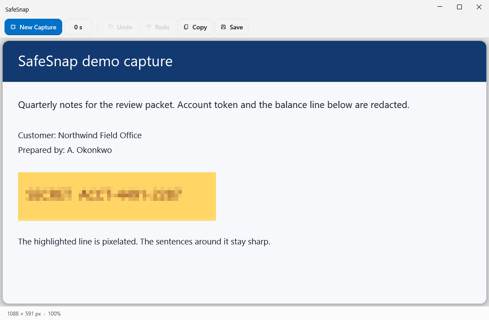
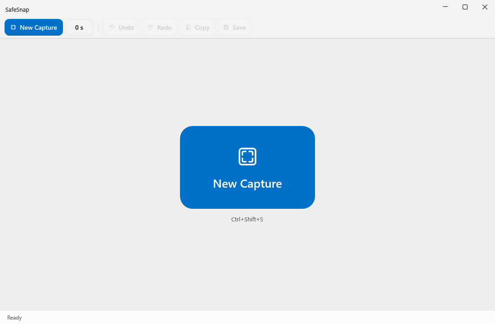
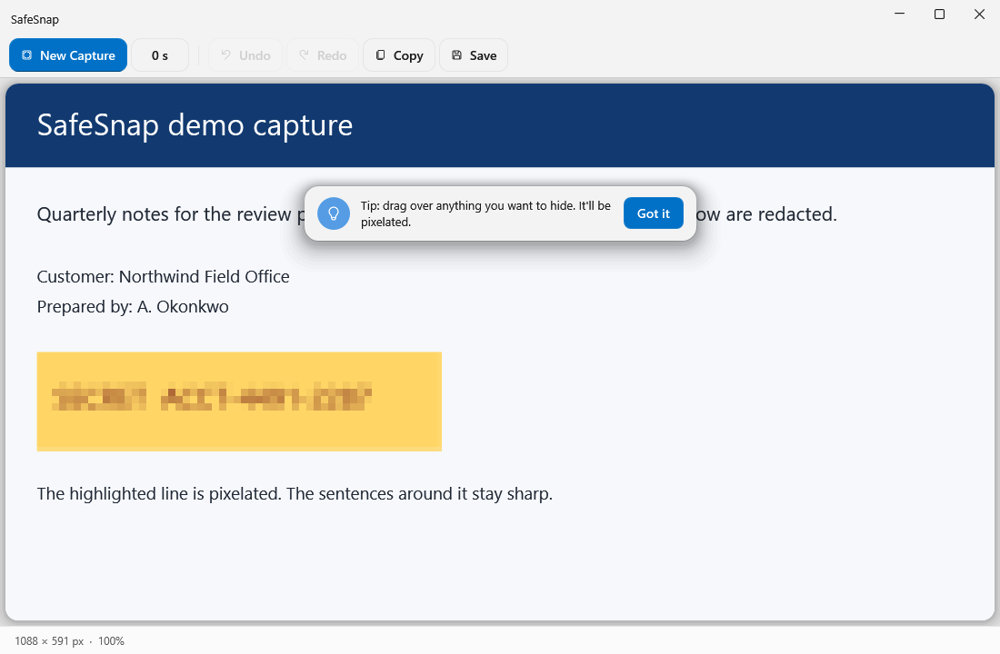

<p align="center">
  
</p>

<h1 align="center">SafeSnap</h1>

<p align="center">
  <b>Capture any region of your screen and pixelate sensitive info before you share it.</b><br>
  A fast, clean, privacy-first screenshot tool for Windows.
</p>

<p align="center">
  <a href="https://github.com/sirchas/SafeSnap/releases/latest"></a>
  <a href="LICENSE"></a>
  
  
</p>

<p align="center">
  
</p>

---

## Why SafeSnap?

Sharing a screenshot in a ticket, chat, or email often means exposing things you shouldn't: names, account numbers, email addresses, internal hostnames. SafeSnap makes it a two-second job: **snip, drag a box over the sensitive part, copy.** The pixelation is burned into the image, so the hidden text can't be recovered.

## Features

- 🖼️ **Region capture like Snipping Tool.** Freezes all monitors, dims the screen, and lets you drag a selection with crosshair guides and a live pixel-size readout. Handles multiple monitors and mixed DPI scaling (per-monitor DPI aware).
- 🟦 **Always-on pixelate.** Just drag over anything sensitive (no tool to pick) and it's mosaicked. The edit is **destructive**: pixels are actually replaced, not overlaid.
- ↩️ **Undo / Redo** for every pixelate step.
- 📋 **Copy to clipboard** as a real bitmap plus PNG, so it pastes cleanly into Outlook, Teams, Word, Slack, and more.
- 💾 **Save as PNG** to `Pictures\SafeSnap` with a timestamped filename.
- ⌨️ **Global hotkey** `Ctrl+Shift+S` works from anywhere, even when SafeSnap is in the tray.
- ⏱️ **Capture delay** (0 / 3 / 5 s) for menus and tooltips.
- 🧭 **System tray.** Closing the window keeps SafeSnap ready in the tray; single-instance.
- 🌗 **Modern Windows 11 look** with Fluent design and Mica, following your light/dark theme.

<p align="center">
  &nbsp;
</p>

## Download & install

Grab the latest build from the **[Releases page](https://github.com/sirchas/SafeSnap/releases/latest)**:

| File | What it is |
|---|---|
| `SafeSnap-Setup-1.0.1.exe` | **Recommended.** Per-user installer (no admin needed). Adds a Start Menu shortcut, optional Desktop icon, and an uninstaller. |
| `SafeSnap-1.0.1-portable-win-x64.exe` | Portable single file. No install; just run it. |

Both are self-contained (no .NET install required). Windows 10/11 x64.

> **SmartScreen note:** SafeSnap isn't code-signed yet, so Windows may show *"Windows protected your PC"*. Click **More info → Run anyway**. You can verify your download against `SHA256SUMS.txt` on the release page.

## Usage

1. Click **New Capture** (or press `Ctrl+Shift+S` anywhere).
2. Drag a region on the frozen screen. `Esc` cancels.
3. Drag over anything sensitive; it's pixelated instantly (no tool to select). A one-time tip reminds you on your first capture.
4. **Copy** or **Save**.

### Keyboard shortcuts

| Shortcut | Action |
|---|---|
| `Ctrl+Shift+S` | New capture (global, works from the tray) |
| `Esc` | Cancel the current capture |
| `Ctrl+C` | Copy image to clipboard |
| `Ctrl+S` | Save as PNG |
| `Ctrl+Z` / `Ctrl+Y` | Undo / Redo |

### Tray behavior

Closing the window (✕) hides SafeSnap to the system tray so the hotkey stays available. **Double-click** the tray icon to reopen it. **Right-click** gives *New Capture*, *Open*, and *Exit*. Launching SafeSnap again brings up the existing window.

## Privacy

- **Pixelation is destructive.** The exported image contains only the mosaic blocks; the original pixels in that area are gone.
- **Everything stays local.** SafeSnap makes no network connections, has no telemetry, and has no accounts. Images go only where you copy or save them.

## Build from source

Requirements: Windows 10/11, [.NET 8 SDK](https://dotnet.microsoft.com/download/dotnet/8.0).

```powershell
git clone https://github.com/sirchas/SafeSnap.git
cd SafeSnap
dotnet build SafeSnap.sln
dotnet test SafeSnap.sln

# Single-file, self-contained exe -> .\publish\SafeSnap.exe
dotnet publish src\SafeSnap\SafeSnap.csproj -c Release -r win-x64 --self-contained true -p:PublishSingleFile=true -p:IncludeNativeLibrariesForSelfExtract=true -o publish

# Optional installer (requires Inno Setup 6) -> installer\Output\
ISCC.exe installer\SafeSnap.iss
```

Built with WPF on .NET 8 and [WPF-UI](https://github.com/lepoco/wpfui).

## License

[MIT](LICENSE) © 2026 Charles Wells
